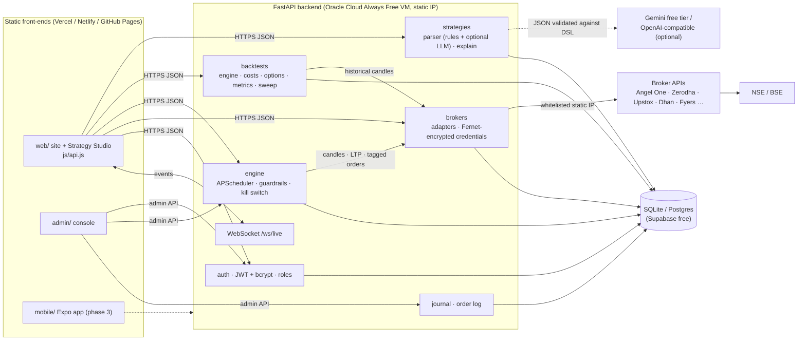

# TradeCognix

**Plain-English algorithmic trading for Indian brokers.** Describe a strategy the way you would say it out loud ("Buy Nifty ATM call when 9 EMA crosses above 21 EMA on 15-min candles after 9:30 AM, exit on opposite cross or 3:15 PM, max 2 trades a day"). TradeCognix turns it into structured rules, backtests it with real Indian costs, paper-trades it, and only then, with explicit server-side and in-app confirmation, places orders through **your own** broker account.

**Live site:** https://artha00777.github.io/tradecognix/ (demo mode, runs in the browser) · admin console at [/admin/](https://artha00777.github.io/tradecognix/admin/)

> © 2026 DevCognix. Proprietary, see [LICENSE](LICENSE). Contact: contact@devcognix.com · +91 901 908 8160

---

## What's in the repo

| Path | What it is |
|---|---|
| `backend/` | Python 3.11, FastAPI, SQLModel (SQLite by default, Postgres via `DATABASE_URL`), pydantic-settings |
| `backend/app/strategy/` | Strategy DSL (pydantic), rule-based plain-English parser (+ Hinglish basics), optional LLM parser (Gemini free tier or any OpenAI-compatible endpoint) with fallback, DSL → English explainer |
| `backend/app/indicators.py` | EMA, SMA, RSI (Wilder), VWAP (session), ATR, Supertrend, opening range, crossovers |
| `backend/app/backtest/` | Event-driven backtester, Indian cost model (`rates.py` holds every rate in one place), ATM/ITM/OTM strike selection, Black-Scholes premium proxy (flagged), metrics, whipsaw detection, parameter sweeps |
| `backend/app/brokers/` | `BrokerAdapter` interface, Angel One SmartAPI (full), Zerodha / Upstox / Dhan / Fyers (best-effort real), Groww / ICICI / Kotak Neo / 5paisa / Alice Blue / Shoonya (documented skeletons), PaperBroker |
| `backend/app/engine/` | APScheduler engine running strategies on candle close, guardrails, kill switch, order tagging, journal writes |
| `backend/app/api/` | REST: auth (JWT + bcrypt, roles), brokers, strategies, backtests, paper/live, journal, admin; WebSocket `/ws/live` |
| `web/` | The designed marketing site + app prototype. `web/js/api.js` wires it to the backend when `TC_API_BASE` is set; otherwise it runs as a self-contained demo |
| `admin/` | Static admin console (users, strategies, live sessions, stats, platform kill switch) |
| `mobile/` | Phase-3 plan for the Expo React Native app |
| `brand/` | Logo and mark |
| `docs/ROADMAP.md` | Phases 2-3, feature and revenue ideas |
| [`docs/AUDIT.md`](docs/AUDIT.md) | Nov 2026 audit: bugs fixed by area and known gaps |
| [`docs/GROWTH.md`](docs/GROWTH.md) | Growth plan, pricing rationale and NSE static-IP circular notes |

## Architecture



**One DSL everywhere.** The parser, backtester, live engine and explainer all speak the same `Strategy` schema (`backend/app/strategy/dsl.py`), and signals come from one shared evaluator (`strategy/evaluate.py`). What you backtest is what the engine runs.

## Quickstart (local)

Requires Python 3.11+.

```bash
cd backend
python -m venv .venv && source .venv/bin/activate
pip install -r requirements-dev.txt          # core + pytest
pip install -r requirements-brokers.txt      # optional: broker SDKs (Angel One, Zerodha, Dhan, Fyers)

cp ../.env.example .env
python -c "from cryptography.fernet import Fernet;print('FERNET_KEY='+Fernet.generate_key().decode())" >> .env
# edit .env: JWT_SECRET, ADMIN_EMAILS, CORS_ORIGINS ...

python -m pytest                              # run the test suite
uvicorn app.main:app --reload                 # API on http://localhost:8000 (docs at /docs)
```

Try it without a broker (synthetic NIFTY 5-minute candles are generated on the fly):

```bash
python -m scripts.backtest_cli "Buy Nifty ATM call when 9 EMA crosses above 21 EMA on 15-min candles after 9:30 AM. Exit on opposite cross or 3:15 PM. Max 2 trades a day."
python -m scripts.backtest_cli "Nifty 9/21 EMA crossover both directions, hard exit 3:15, ATM buy" --sweep   # 5/15/30-min x ATM buy/ITM buy/ATM sell x entry times
python -m scripts.generate_sample_data --symbol NIFTY --days 120            # writes backend/data/nifty_5m_synthetic.csv
python -m scripts.create_admin you@example.com 'a-strong-password'
```

Front-ends:

```bash
# from the repo root
python -m http.server 8080
# site in demo mode:          http://localhost:8080/web/
# site wired to your API:     http://localhost:8080/web/?api=http://localhost:8000   (remembered; ?api=off to reset)
# admin console:              http://localhost:8080/admin/
```

Or set `window.TC_API_BASE` permanently in `web/js/config.js` before deploying.

With Docker (backend + Postgres):

```bash
cp .env.example .env   # fill FERNET_KEY, JWT_SECRET, POSTGRES_PASSWORD
docker compose up -d --build
```

### Connecting Angel One

1. Create a SmartAPI app at <https://smartapi.angelbroking.com> and note the **API key**.
2. Enable TOTP for your account and keep the **TOTP secret** (the base32 string behind the QR code).
3. Register your server's **static IP** on the SmartAPI app (required for orders).
4. In the app: Brokers → Angel One → enter API key, client code, PIN and TOTP secret. Credentials are encrypted with Fernet (`FERNET_KEY`) before they touch the database, and the connection is tested by logging in and reading your profile.

## How a strategy runs

1. **Parse** `POST /api/strategies/parse`: plain English → `Strategy` JSON + a plain-English explanation for confirmation. The rule-based parser handles EMA/SMA crossovers (incl. `9/21 EMA`), RSI levels, VWAP pullbacks, Supertrend flips, opening-range breakouts, fixed-time entries (straddles/strangles), NIFTY/BANKNIFTY/FINNIFTY/MIDCPNIFTY/SENSEX and NSE equities, call/put/buy/sell → option mode (ATM/ITM/OTM buy, ATM sell = "sell the opposite option", straddle/strangle), times like `9:30` / `3:15 pm`, lots, SL/target/trailing %, max trades/day and daily loss caps. With `GEMINI_API_KEY` (or `OPENAI_BASE_URL`) set, an LLM produces the JSON first, it is validated against the schema, and any failure falls back to the rule parser.
2. **Backtest** `POST /api/backtests/run`: signals on bar close, fills at close ± slippage, intrabar SL/target from the underlying's high/low, entry window and hard exit enforced, intraday square-off. Costs per order leg: brokerage (₹20 flat, configurable), STT, exchange transaction charges + IPFT, SEBI fee, stamp duty, 18% GST, plus slippage as a separate line. Metrics: trades, win rate, gross/net P&L, profit factor, payoff, expectancy, max drawdown, consecutive losses, Sharpe (daily), exit-reason mix and **whipsaws** (losing trades closed by a signal within N bars). `POST /api/backtests/sweep` runs the timeframe × mode × entry-time grid.
3. **Paper** `POST /api/engine/start {mode:"paper"}`: same runner, PaperBroker fills at LTP with slippage. With a connected broker it uses live market data; without one, a synthetic feed.
4. **Live** `POST /api/engine/start {mode:"live", confirm_text:"LIVE"}` succeeds only if **all** hold: `LIVE_TRADING_ENABLED=true` on the server, the strategy was confirmed for live (`POST /api/strategies/{id}/confirm-live`, revoked automatically when its rules change), the user typed `LIVE`, and a real, implemented broker account is connected. The engine re-checks the server flag on every tick and halts live sessions if it is turned off.

Guardrails on every session: max trades/day, daily loss cap (stops entries and squares off), hard exit time, per-user kill switch (`POST /api/engine/kill`) and platform kill switch (`POST /api/admin/kill-all`). Every order carries the strategy's tag (e.g. `TC12NE9E21C`), and every closed trade lands in the journal tagged by strategy.

### Important data caveats

- **Synthetic data**: without a connected broker, backtests run on generated NIFTY-like candles. Results are flagged `synthetic_underlying_data`. They demonstrate the engine, not an edge.
- **Option premiums**: historical option candles are not used yet; premiums are estimated with Black-Scholes at a constant VIX-like IV (default 14%) and flagged `premium_proxy_black_scholes`. Real premiums have skew, IV crush and spreads. Treat option backtests as indicative.
- **Rates**: every charge and contract spec lives in `backend/app/backtest/rates.py`, marked *verify current rates*. Defaults (reviewed 22 Nov 2026): STT on options 0.1% of sell premium before 1 Apr 2026 and **0.15% from 1 Apr 2026** (Budget 2026-27), futures 0.02% → 0.05%; NSE options transaction 0.03503% + IPFT 0.0005%; SEBI ₹10/crore; stamp 0.003% (options buy); GST 18%. Lot sizes NIFTY 65, BANKNIFTY 30, FINNIFTY 60, MIDCPNIFTY 120, SENSEX 20. Weekly expiries: NIFTY (Tuesday) and SENSEX (Thursday) only.

## API overview

Interactive docs at `/docs`. Main routes:

| Area | Routes |
|---|---|
| Auth | `POST /api/auth/register`, `POST /api/auth/login`, `POST /api/auth/token` (OAuth2 form), `GET /api/auth/me` |
| Brokers | `GET /api/brokers`, `GET /api/brokers/static-ip`, `GET/POST /api/brokers/accounts`, `POST /api/brokers/accounts/{id}/test`, `GET …/{id}/funds`, `GET …/{id}/credentials` (masked), `DELETE …/{id}` |
| Strategies | `POST /api/strategies/parse` (public), `POST /api/strategies/explain`, `GET /api/strategies/schema`, CRUD on `/api/strategies`, `POST /api/strategies/{id}/confirm-live`, `…/revoke-live` |
| Backtests | `POST /api/backtests/run` (public on synthetic data), `POST /api/backtests/sweep`, `GET /api/backtests`, `GET /api/backtests/{id}`, `GET /api/backtests/{id}/trades` |
| Paper / live | `POST /api/engine/start`, `POST /api/engine/{sid}/stop`, `POST /api/engine/kill`, `GET /api/engine/status`, `GET /api/engine/sessions`, `GET /api/engine/orders`, `POST /api/engine/tick` (admin: force a tick, optionally at a simulated time) |
| Journal | `GET /api/journal`, `GET /api/journal/summary`, `PATCH /api/journal/{id}`, `GET /api/journal/export.csv` |
| Admin | `GET /api/admin/users`, `PATCH /api/admin/users/{id}`, `GET /api/admin/strategies`, `GET /api/admin/sessions`, `POST /api/admin/sessions/{id}/kill`, `POST /api/admin/kill-all`, `GET /api/admin/stats` |
| Waitlist | `POST /api/waitlist` (public, rate-limited): `{email, plan: pro|elite}`; payments are disabled during beta |
| Billing (dormant) | `GET /api/billing/plans` (public price list), `GET /api/billing/usage`, `POST /api/billing/checkout` (Razorpay order; 503 until keys are set), `POST /api/billing/verify` (signature check, activates the plan), `POST /api/billing/webhook` (`order.paid` / `payment.captured`) |
| Realtime | `WS /ws/live?token=<jwt>`: session status, orders, trades, events |

## Plans and billing

Limits are enforced server-side in `backend/app/billing/plans.py` (the single source of truth); admins are never limited, and an expired paid plan behaves as Free.

| Plan | Price (INR) | Backtests/day | Strategies | Sweeps | Live trading |
|---|---|---|---|---|---|
| Free | ₹0 | 5 | 1 | No | No (paper only) |
| Pro | ₹999/month or ₹9,990/year | 100 | 5 | Yes | Yes |
| Elite | ₹2,499/month (monthly only) | Unlimited | Unlimited | Yes | Yes |

**Payments disabled during beta.** The site does not take payments and never loads Razorpay. Get Pro / Get Elite open an inline "Free during beta — join the waitlist" form: with a backend configured it posts to `POST /api/waitlist` (public, rate-limited, one row per email in `WaitlistEntry`); in demo mode (including the GitHub Pages site) the email is only kept in the visitor's `localStorage` and nothing is sent. Plan limits are still enforced server-side; during beta an admin can grant Pro/Elite with `PATCH /api/admin/users/{id}`.

The Razorpay billing code is kept but dormant: `POST /api/billing/checkout` returns an order, Razorpay Checkout runs on the client, then `POST /api/billing/verify` checks the signature and activates the plan (the webhook activates it too). It answers 503 until `RAZORPAY_KEY_ID` / `RAZORPAY_KEY_SECRET` are set, and nothing in `web/` calls it. To turn payments on later, set the keys and wire the Pro/Elite buttons back to checkout.

## Deploying for free

| Piece | Free option | Notes |
|---|---|---|
| `web/` and `admin/` | **Vercel** or **Netlify** (or GitHub Pages) | Pure static. Point the project root at `web/` (and a second project at `admin/`). Set `TC_API_BASE` in `web/js/config.js`. Add the site origins to `CORS_ORIGINS`. |
| Backend for **live** trading | **Oracle Cloud Always Free** VM (Ampere A1 / E2.1.Micro) with a **reserved public IP** | Brokers only accept API orders from a whitelisted static IP. Run `deploy/oracle-vm-setup.sh`, then `docker compose up -d --build`, put Caddy in front (`deploy/Caddyfile`) for free HTTPS, and register the reserved IP with your broker. Set `STATIC_IP` in `.env`; `GET /api/brokers/static-ip` confirms the egress IP matches. |
| Backend for **paper/demo** only | **Render** free web service (`render.yaml`) | Sleeps when idle and has no static egress IP: fine for demos and paper, not for live orders. Keep `LIVE_TRADING_ENABLED=false`. |
| Database | **Supabase** free Postgres | Paste the connection string into `DATABASE_URL` (`postgres://` URLs are normalised automatically). SQLite is fine on a single VM. |
| LLM (optional) | **Google Gemini** free tier, or a local **Ollama** via `OPENAI_BASE_URL` | Without either, the deterministic parser does everything. |

Run exactly **one** backend process (the Dockerfile uses one uvicorn worker): the trading scheduler must not run twice.

## SEBI retail-algo compliance notes

SEBI's circular *Safer participation of retail investors in Algorithmic trading* (4 Feb 2025) applies to every stock broker from **1 April 2026**. In practice, for a platform like this:

- **Broker is the principal.** Orders go through each user's own broker API; TradeCognix never holds client funds. Brokers answer for algo orders on their APIs and must approve/register algos and algo providers with the exchanges. **Before offering TradeCognix to other people, get empanelled / approved through each partner broker** (and, for black-box strategies sold to others, the provider must be a SEBI-registered Research Analyst). Running your own strategies on your own account is the simplest case.
- **Static IP is only for self-coders (NSE circular NSE/INSP/77559, 20 Nov 2026, effective immediately).** A client static IP is allowed only for *tech-savvy retail investors who develop their own algos using programming knowledge*, with a signed undertaking via their broker. Everyone else must run vendor/no-code algos through an **exchange-empanelled algo provider with strategies hosted on the broker's servers** (orders originate from the broker). Algo providers that hand static IPs to ordinary clients risk suspension or revocation of empanelment. For TradeCognix this means: (a) running the engine on your *own* account from your *own* static IP is fine only if you qualify as tech-savvy; (b) offering live trading to plain-English users requires empanelment and broker-hosted deployment, not a shared or managed static IP. Until then, keep `LIVE_TRADING_ENABLED=false` for public users.
- **Order tagging.** API orders carry an exchange-issued algo identifier, applied by the broker. TradeCognix additionally tags every order with a strategy tag (`ordertag` / `tag` / `orderTag` per broker) and logs it, so each order traces back to a strategy, session and user.
- **Order-rate threshold.** Algos above the exchange threshold (10 orders/second per exchange) need separate registration with an algo ID. TradeCognix strategies trade on candle close and stay far below that.
- **Controls.** Kill switches, daily loss caps, max trades, hard exits, explicit live enablement and audit logs (`OrderLog`, `JournalEntry`) are built in. Keep them on.

This is a summary for engineering purposes, not legal advice. Verify against the SEBI circular, the NSE/BSE implementation standards and your broker's current API terms.

## Risk disclaimer

Trading in equities, futures and options involves substantial risk of loss and is not suitable for everyone. SEBI studies found that most individual F&O traders lose money. Backtests (especially on synthetic data or estimated option premiums) are hypothetical, do not account for every market condition, and **are not indicative of future results**. TradeCognix is software, not investment advice; nothing here is a recommendation to buy or sell any security. Start with paper trading, use small size when live, and keep the kill switch within reach.

## Status: what is real and what is a skeleton

| Component | Status |
|---|---|
| Parser, DSL, explainer, indicators, backtester, costs, metrics, sweeps | Implemented and tested |
| Paper engine, guardrails, kill switches, journal, admin, WebSocket | Implemented and tested |
| Angel One SmartAPI adapter | Fully implemented against `smartapi-python` + `pyotp` (login, profile, funds, candles with chunking, LTP, place/cancel order with `ordertag`, positions, order book, scrip-master instrument search and option resolution). Not exercised against a live account in CI. |
| Zerodha, Upstox, Dhan, Fyers adapters | Best-effort real implementations from the public SDKs/APIs; need verification with real accounts. Zerodha/Upstox/Fyers logins are OAuth redirects (paste request/auth code or a day's access token). |
| Groww, ICICI Direct (Breeze), Kotak Neo, 5paisa, Alice Blue, Shoonya | Documented skeletons: credential fields + implementation notes; every method raises `NotImplementedError`. |
| Live futures routing | Not yet: live/paper sessions support options and equity; futures backtest at spot (flagged). |
| Historical option premiums | Not yet: Black-Scholes proxy (flagged). |
| Mobile app | Plan only (`mobile/README.md`). |

## Development

```bash
cd backend && python -m pytest          # 111 tests: parser, indicators, costs, backtest, engine, brokers, security, billing, waitlist, API
```

CI (`.github/workflows/ci.yml`) runs the tests and a CLI smoke backtest on every push. `.github/workflows/pages.yml` deploys `web/` to the GitHub Pages root and `admin/` to `/admin/`. See [`docs/AUDIT.md`](docs/AUDIT.md) for what the Nov 2026 audit fixed and what is still open.
